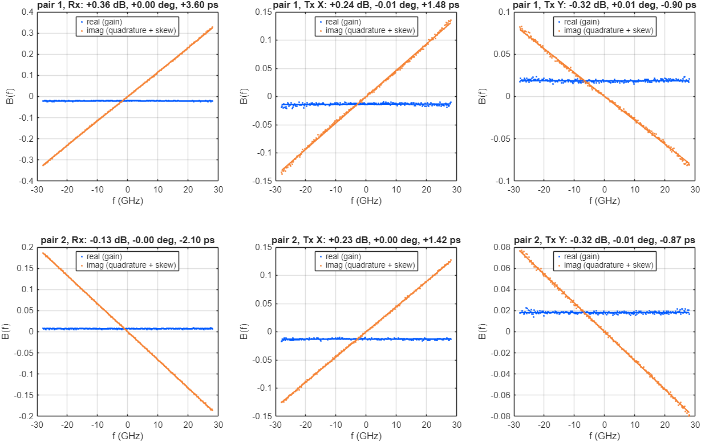

# iq-skew-split

Measure the I/Q skew, gain imbalance and quadrature error of a coherent
**transmitter and receiver separately**, per frequency, from ordinary data
captures with known symbols. No test tones and no extra hardware: the random
carrier-phase drift between captures does the separating.

One MATLAB function, `iq_skew_split.m`, with no toolbox dependencies.



## The problem

Every I/Q imbalance, whether in the transmitter or the receiver, shows up in
the received signal as an image: a little of the conjugate spectrum at `-f`
leaking into `f`. A receiver-side widely linear equaliser can measure the total
image, but not which side caused it. That matters, because the two are fixed
in different places: transmitter skew is trimmed at the DAC/AWG, receiver skew
in the receiver DSP. Correcting the total at one end leaves the other end
wrong.

A second difficulty: skew makes an image that is **odd in frequency**
(`B(f) ≈ iπfτ`). Any measurement that averages over the band reads it as zero.

## The idea

Write the received spectrum as

```
Z(f) = A(f) T(f) + B(f) conj(T(-f))
```

and take the ratio

```
rho(f) = B(f) / conj(A(-f)) = B_rx(f) + B_tx(f) · lambda,   lambda = J / conj(J)
```

Anything common to I and Q (delay, loss, a real filter) cancels in the ratio.
The receiver image is fixed to the ADC axes and stays constant. The transmitter
image is seen through the optical carrier phase θ, once directly and once
conjugated, so it is multiplied by `lambda`: `exp(2iθ)` for one polarisation,
or the phase of each Jones-matrix element for two.

θ drifts randomly between captures. Regressing `rho` against
`[1, lambda, conj(lambda)]` **in every frequency bin** therefore separates the
two sides. The `conj(lambda)` column has no physical source; it is kept as a
direct measure of the noise floor of the split.

Each side's `B(f)` is then fitted with a straight line in `f`:

| part of the line | gives |
| --- | --- |
| real intercept | gain imbalance |
| imaginary intercept | quadrature error |
| imaginary slope | skew |

What the line leaves is ripple. Its inverse FFT gives the round-trip delay of
the RF reflection causing it (`S.pair{q}.rx.echo`).

## Usage

```matlab
% Z : 1 x K cell of Ns x nPair complex symbol-rate captures, before any I/Q
%     imbalance correction (one column per receive I/Q pair)
% T : Ns x nTrib known transmitted symbols (one column per tributary)
% Fs: symbol rate, Hz
S = iq_skew_split(Z, T, Fs, 'plot', true);

S.pair{1}.rx.skew_ps      % receiver skew, pair 1
S.pair{1}.tx{1}.skew_ps   % transmitter skew of tributary 1, seen through pair 1
S.txSkew_ps               % nTrib x nPair: every transmitter through every pair
```

Single polarisation is the 1 x 1 case. With two polarisations, each
transmitter is measured once through each receive pair; agreement between the
two is a free consistency check on the Tx reading.

Options: `'fmax'` (fit band, default `0.44*Fs`), `'Nfft'` (default 256),
`'align'` (find an integer delay for a looping test pattern), `'minElemFrac'`,
`'minRows'`, `'tribName'`, `'verbose'`, `'plot'`. See `help iq_skew_split`.

Run the demos and tests:

```matlab
cd examples
demo_single_pol
demo_dual_pol

cd ../tests
run_tests
```

## Sign conventions

- `gain_dB = 20*log10(|Q|/|I|)`
- `quad_deg = φ`, where the Q branch reads `Q·cos φ + I·sin φ`
- `skew_ps > 0` means Q lags I

## Requirements and limits

- **Known symbols, frame-aligned, one sample per symbol.** The function does
  not equalise or synchronise. Pass the output of your timing recovery, before
  I/Q imbalance compensation. `'align', true` handles an integer delay on a
  looping pattern only.
- **The carrier phase (or polarisation state) must change between captures.**
  The reported `lever = |mean(lambda)|` says whether it did: near 0 is good,
  above about 0.5 the split is unreliable, 1 means no spread at all.
  Ten to twenty captures over a few minutes of fibre drift are typically
  enough.
- **The phase must be static within one capture**: the same laser for the
  transmitter and the local oscillator (self-homodyne), or a frequency offset
  and phase noise that are negligible over the capture.
- **The link between transmitter and receiver must have a real impulse
  response**, apart from the carrier phase. Uncompensated chromatic dispersion
  breaks the cancellation of the transmitter term, because
  `H(f)/conj(H(-f))` is no longer 1. Back-to-back or short links work.
- **The transmitter quadrature-error reading is biased** by the receiver's own
  phase response. The transmitter skew and gain readings are not affected.

## Accuracy

On the synthetic link in `examples/simulate_link.m` (64 GBd 16-QAM, 20
captures of 32768 symbols, 30 dB SNR, two polarisations with different defects
on every modulator and receive pair) the split recovers skew to within
0.1 ps and gain to within 0.02 dB on both sides, and the null term stays below
0.2 % of the signal. `tests/run_tests.m` checks this.

On a 64 GBd lab bench, delaying Q by 2.50 ps in the receiver DSP was read back
as 2.508 ps.

## Related work

The model is well known. Widely linear processing goes back to [1]; joint Tx
and Rx I/Q imbalance on either side of a carrier rotation was worked out for
OFDM radios [2, 3]; using that rotation to separate the two sides was done for
wireless [4] and for coherent optics [7, 8]. Frequency-resolved Tx and Rx skew
has been measured with multi-tone test signals [9, 10].

What differs here: the regressor is the random carrier phase **between
separate captures**, rather than a frequency offset [4, 8] or the carrier
recovery [7]; the signal is ordinary traffic with known symbols rather than a
test signal; and the per-bin regression carries a null term with no physical
cause, which sets the noise floor of the split. This is based on our own
literature search, which may be incomplete; pointers to related work are
welcome.

1. B. Picinbono, P. Chevalier, "Widely linear estimation with complex data,"
   IEEE Trans. Signal Process., 1995.
   [doi:10.1109/78.403373](https://doi.org/10.1109/78.403373)
2. A. Tarighat, A. H. Sayed, "Joint compensation of transmitter and receiver
   impairments in OFDM systems," IEEE Trans. Wireless Commun. 6(1), 2007.
   [doi:10.1109/TWC.2007.05135](https://doi.org/10.1109/TWC.2007.05135)
3. D. Tandur, M. Moonen, "Joint adaptive compensation of transmitter and
   receiver IQ imbalance under carrier frequency offset in OFDM-based systems,"
   IEEE Trans. Signal Process., 2007.
   [doi:10.1109/TSP.2007.898788](https://doi.org/10.1109/TSP.2007.898788)
4. X. Huang, J. A. Zhang, Y. J. Guo, "Joint transmitter and receiver I/Q
   imbalance estimation in presence of carrier frequency offset," ISCIT 2015.
   [doi:10.1109/ISCIT.2015.7458344](https://doi.org/10.1109/ISCIT.2015.7458344)
5. M. S. Faruk, K. Kikuchi, "Compensation for in-phase/quadrature imbalance in
   coherent-receiver front end for optical QAM," IEEE Photon. J. 5, 2013.
   [doi:10.1109/JPHOT.2013.2251872](https://doi.org/10.1109/JPHOT.2013.2251872)
6. E. P. da Silva, D. Zibar, "Widely linear equalization for IQ imbalance and
   skew compensation in optical coherent receivers," J. Lightw. Technol. 34(15),
   2016. [doi:10.1109/JLT.2016.2577716](https://doi.org/10.1109/JLT.2016.2577716)
7. C. Ju, N. Liu, C. Li, "In-service blind transceiver IQ imbalance and skew
   monitoring in long-haul non-dispersion managed coherent optical systems,"
   IEEE Access 7, 2019.
   [doi:10.1109/ACCESS.2019.2947467](https://doi.org/10.1109/ACCESS.2019.2947467)
8. Q. Zhang et al., "Multi-dimensional, wide-range, and
   modulation-format-transparent transceiver imbalance monitoring,"
   J. Lightw. Technol. 39(7), 2021.
   [doi:10.1109/JLT.2020.3045326](https://doi.org/10.1109/JLT.2020.3045326)
9. L. Dai et al., "Experimental demonstration of simultaneously precise Tx and
   Rx skew calibration for coherent optical transceiver," J. Lightw. Technol.
   40(4), 2022. [doi:10.1109/JLT.2021.3125094](https://doi.org/10.1109/JLT.2021.3125094)
10. L. Dai et al., "Frequency-dependent impairment calibration and estimation
    for a 96 GBaud coherent optical transceiver," Commun. Eng. 3, 2024.
    [doi:10.1038/s44172-023-00147-3](https://doi.org/10.1038/s44172-023-00147-3)

## License

BSD 3-Clause. See [LICENSE](LICENSE).
